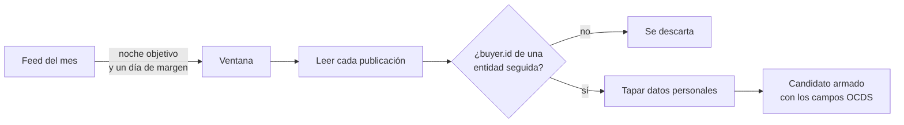

# Compras estatales (ARCE)

Verificada el 2026-11-07 (tarjeta T10). **Veredicto: entra en la versión 0 y es la fuente de la primera rebanada** ([ADR 0006](../../adrs/0006-fuentes-de-la-version-0.md)).

La Agencia Reguladora de Compras Estatales (ARCE) publica las compras del Estado gestionadas en su sistema (SICE).

## Qué publica

- Publicaciones en formato OCDS (*Open Contracting Data Standard*, el estándar abierto de datos de contrataciones públicas): llamados, aclaraciones, ajustes, adjudicaciones y cancelaciones, desde diciembre de 2017. Cada una trae comprador, proveedor adjudicado con su RUT, ítems, fechas y documentos. [PROVEN: https://www.gub.uy/agencia-reguladora-compras-estatales/datos-y-estadisticas/datos/open-contracting, 2026-11-07]
- No incluye las compras centralizadas, los convenios marco, las ampliaciones ni las renovaciones. [PROVEN: política de publicación OCDS de ARCE, https://www.gub.uy/agencia-reguladora-compras-estatales/sites/agencia-reguladora-compras-estatales/files/2025-11/politica-de-publicacion-ocds.pdf, 2026-11-07]
- Hay además un histórico de 2002 a 2025, un archivo por año. [PROVEN: https://catalogodatos.gub.uy/dataset/arce-datos-historicos-de-compras, 2026-11-07]

## Cómo se accede

Una API sin clave, que devuelve JSON en OCDS 1.1. [PROVEN: llamadas de prueba con respuesta HTTP 200, 2026-11-07]

| Ruta | Qué devuelve |
|---|---|
| `https://www.comprasestatales.gub.uy/ocds/rss/AAAA/MM` | Todas las publicaciones de un mes, en un feed. |
| `https://www.comprasestatales.gub.uy/ocds/release/<id>` | Una publicación, en JSON, con su licencia. |
| `https://www.comprasestatales.gub.uy/ocds/record/<id>` | La historia completa de una compra. |
| `https://www.comprasestatales.gub.uy/ocds/rss` | Las últimas 500 publicaciones. No alcanza para una noche. |

El feed de las últimas 500 no sirve para El Parte: en los días hábiles de octubre de 2026 se publicaron entre 550 y 670 por día. [PROVEN: conteo sobre el feed mensual, 2026-11-07] El explorador usa el feed mensual.

## Permiso de uso

- Los datos se publican con la Licencia de Datos Abiertos de Uruguay (Decreto 54/017). Permite usarlos para fines comerciales y no comerciales, y exige citar el origen. [PROVEN: https://www.gub.uy/agencia-reguladora-compras-estatales/datos-y-estadisticas/datos/licencia-datos-abiertos, 2026-11-07] Cada JSON enlaza a esa licencia en su campo `license`. [PROVEN: llamada de prueba, 2026-11-07]
- El host de la API no tiene robots.txt: la ruta redirige a una página HTML. [PROVEN: 2026-11-07] Por lo tanto, no hay reglas que restrinjan `/ocds/`. [INFERRED]
- El catálogo nacional pide no usar su API (`Disallow: /api/`) y esperar 10 segundos entre pedidos, pero permite bajar los archivos. [PROVEN: https://catalogodatos.gub.uy/robots.txt, 2026-11-07] El explorador no usa la API del catálogo.

## Consulta por fecha

Sí. El feed mensual trae todo lo publicado en un mes: octubre de 2026 tiene 9.393 publicaciones. [PROVEN: `https://www.comprasestatales.gub.uy/ocds/rss/2026/10`, 2026-11-07] Para repetir una noche se filtran las publicaciones por su fecha de publicación (`pubDate`). [INFERRED]

Hay dos cosas para resolver antes de la primera rebanada (tablero, T08):

- **La zona horaria.** La `pubDate` del feed no trae zona horaria, y el JSON muestra la misma hora con "Z" (UTC). No se pudo verificar si es UTC o la hora de Uruguay. Importa para saber dónde termina una noche. [PROVEN que falta la zona, 2026-11-07]
- **Publicaciones atrasadas.** El feed de octubre de 2026 no tiene publicaciones entre el 23 y el 29, y después hay picos (el 3 de noviembre, 1.919). [PROVEN: conteo, 2026-11-07] Lo probable es una caída con publicación atrasada. [INFERRED] Para El Parte, la fecha que manda es la de publicación, no la del acto.

## Lo que se aprendió en la primera rebanada

Las dos cosas de arriba quedaron resueltas al construir el explorador (tablero, T08), y aparecieron otras:

- **La hora es la de Uruguay.** En el feed de noviembre de 2026, casi todo se publica entre las 7 y las 17 de la hora que da el feed, que es el horario de oficina en Uruguay; si fuera UTC, el pico caería entre las 4 y las 14 de Uruguay. [INFERRED: histograma de las horas de publicación del feed de noviembre, 2026-11-14] El explorador toma las horas del feed y del JSON como hora de Uruguay, aunque el JSON diga "Z", y la noche objetivo es un día de Uruguay.
- **ARCE publica con atraso.** Leído el 2026-11-14, el feed del mes terminaba el 13 a las 12:25. [PROVEN: 2026-11-14] Por eso el explorador lee la noche objetivo y un día de margen hacia atrás (`elparte.arce.dias-de-margen`). Lo que ya estaba lo descarta el archivista, y lo que es del día de margen se publica con la fecha marcada como no confirmada.
- **El BPS compra con el código 28-1.** En el JSON, `buyer.id` es `28-1` y `buyer.name` es "Banco de Previsión Social": 43 de las 712 publicaciones del 2026-11-12. [PROVEN: lectura de las publicaciones de ese día, 2026-11-14] La entidad `organismo:bps` de la base lleva ese código en sus identificadores.
- **El feed no dice quién compra.** Cada entrada trae identificador, fecha y categoría, pero no el comprador. [PROVEN: 2026-11-14] Hay que leer cada publicación de la noche para saber si es del BPS; ese filtro se hace antes de cualquier otra cosa, y sin el modelo.
- **Solo HTTPS.** Por HTTP la API responde 503. [PROVEN: 2026-11-14]
- **Las etiquetas.** Las publicaciones traen `tender`, `tenderAmendment`, `tenderUpdate`, `award`, `awardUpdate` o `tenderCancellation`. [PROVEN: 2026-11-14] El explorador las lleva a `llamado`, `aclaracion`, `adjudicacion` y `cancelacion` ([contratos](../contratos.md)).
- **El explorador no usa el modelo.** La publicación es estructurada, así que el resumen se arma con sus campos (título, ítems, proveedores, monto, fecha de cierre) y la evidencia es la lista de esos campos con su valor. Es más barato, y la misma publicación da siempre el mismo candidato.

## Personas físicas

- Los adjudicatarios se identifican por RUT, y algunos parecen empresas unipersonales. [INFERRED: muestra de ocho publicaciones]
- En los llamados, el campo `parties[].contactPoint` trae nombre, correo y teléfono del contacto del comprador. [PROVEN que el campo existe, 2026-11-07]
- El explorador descarta `contactPoint` al leer, y el nombre de un adjudicatario persona física se enmascara (D3).
- Los proveedores se identifican con una "R" y los doce dígitos del RUT. [PROVEN: 2026-11-14] Como ARCE no dice si un proveedor es una persona, el explorador lo decide por el nombre: si no tiene una marca de sociedad (S.A., S.R.L., Ltda., Cooperativa y otras), se tapa su nombre y su RUT en las adjudicaciones y en `parties`. Ante la duda se tapa, así que algunas empresas quedan como `[persona]`. [PROVEN: `EnmascaradorTest` con datos inventados, 2026-11-14] Cuántas se tapan de más se ve con la medición contra el banco de pruebas (T20).

## Riesgos

- Sin autenticación ni límites declarados; en unas 15 llamadas hubo una conexión cortada. [PROVEN: 2026-11-07]
- Una noche son muchas lecturas: como el feed no dice quién compra, el explorador lee cada publicación de la noche y del día de margen, unas 1.400 en dos días hábiles, de a cuatro a la vez, y reintenta tres veces cada una que falla. [INFERRED: de los conteos de arriba y de la configuración del explorador, 2026-11-14] Si ARCE empieza a cortar conexiones, se baja `elparte.arce.concurrencia`.
- El organismo cambió de nombre y las URLs de su sitio redirigen en cadena. La API puede cambiar de dirección. [PROVEN para las redirecciones, 2026-11-07]
