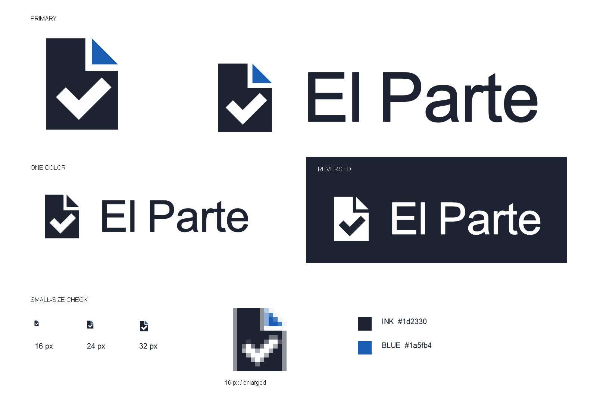

# El logo

El logo de El Parte: una hoja de parte con la esquina doblada y un tilde recortado de su silueta, por los hechos verificados y con su fuente. Sobrio, sin escudos ni sellos que lo confundan con algo oficial.

## Los colores

| Color | Hexadecimal | Dónde va |
|---|---|---|
| Tinta | `#1d2330` | La hoja y las letras. Es la `--tinta` de las páginas de la aplicación. |
| Azul | `#1a5fb4` | La esquina doblada. Es el `--azul` de las páginas de la aplicación. |

Sobre blanco. La versión de un color va en tinta sobre blanco, y la invertida, en blanco sobre tinta.

## Los archivos

| Archivo | Qué es |
|---|---|
| `el-parte-icon-color.svg`, `el-parte-icon-ink.svg`, `el-parte-icon-reversed.svg` | El ícono solo, en color, en tinta y en blanco sobre tinta. Son los originales: para cualquier otro tamaño se parte de estos. |
| `el-parte-lockup-color.svg`, `el-parte-lockup-ink.svg`, `el-parte-lockup-reversed.svg` | El ícono con el nombre al lado, en las mismas tres versiones. Las letras están convertidas en trazos: no hace falta ninguna fuente instalada. |
| `*-sin-fondo.svg` | Las versiones en color y en tinta, del ícono y del logo con el nombre, sin el rectángulo blanco de fondo, para poner sobre un fondo que no es blanco. Salen de los originales sacándoles ese rectángulo y nada más. |
| `el-parte-icon-*.png` | El ícono en PNG: de 512 por 512 sin número en el nombre, y de 16, 24, 32 y 48 píxeles exactos. |
| `el-parte-lockup-*.png` | El logo con el nombre, en PNG de 384 píxeles de alto. |
| `favicon.ico` | El ícono de la pestaña del navegador, con 16, 32 y 48 píxeles adentro. |
| `el-parte-overview.png` | Todas las versiones juntas, y el ícono a 16, 24 y 32 píxeles. |

## Cómo se usa

- Alrededor del logo queda libre por lo menos el ancho de la esquina doblada.
- A tamaño de pestaña va el ícono solo, sin el nombre.
- Para agrandar o achicar se usa el SVG; los PNG son para donde no entra un SVG.

## Dónde está

- **El README** de la raíz, arriba: en color sobre fondo claro y en blanco sobre tinta sobre fondo oscuro.
- **La aplicación:** el ícono en la pestaña y en el menú, y el logo en la página de inicio. Lleva una copia de `favicon.ico`, `el-parte-icon-color.svg` y `el-parte-lockup-color.svg` en `app/src/main/resources/static/`, porque la imagen de la aplicación se arma solo con la carpeta `app/`. El verificador (`herramientas/verificar_docs.py`) avisa si una copia deja de ser igual a la de acá.
- **El sitio de GitHub Pages:** `herramientas/armar_sitio.py` copia esta carpeta al sitio, pone el logo sin fondo en la portada y el ícono sin fondo en el kanban, que tienen fondo gris, y el ícono en la pestaña de cada página.
- **El tablero de arquitectura** lleva el ícono adentro de su plantilla (`docs/tablero-de-arquitectura/plantilla.html`), en blanco sobre su fondo oscuro, porque es una sola página sin dependencias.

## Cómo se hizo

El concepto salió de un generador de imágenes, con un pedido que decía la hoja doblada con un tilde, los dos colores, nada de sellos, escudos, soles ni imágenes de inteligencia artificial, y que se leyera a 16 píxeles. La geometría final se rehízo a mano como trazos vectoriales, con las letras de una grotesca de peso medio, espaciadas a ojo.
