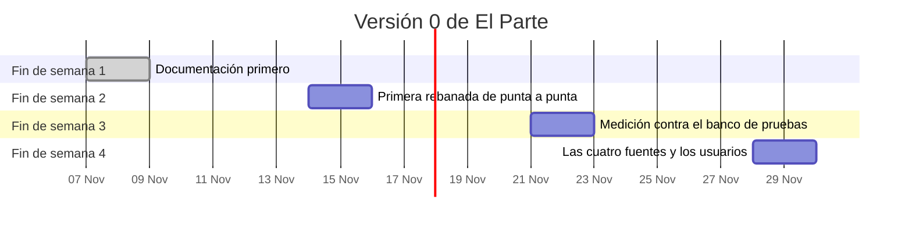

# Plan de la versión 0

Cuatro fines de semana, del 7 al 29 de noviembre de 2026 (D10), con unas seis horas del responsable del proyecto en cada uno para revisar y probar. Cada fin de semana termina con algo que se puede mostrar y una forma concreta de comprobar que está hecho.

El plan se revisa al cierre de cada fin de semana. Lo que se mueve se anota en el CHANGELOG con el motivo.

## Fin de semana 1: documentación primero (7 y 8 de noviembre)

Lo que pide la regla 1 antes de escribir código.

- **Se hace:** carpeta de arranque, README, tablero con kanban, verificación de Spring AI y de las siete fuentes, ADRs 0001 a 0008, arquitectura con su lámina, contratos, modelo de la base y este plan.
- **Se muestra:** el repositorio navegable de punta a punta: un recorrido desde `arranque/` hasta la lámina, los contratos y el kanban.
- **Cómo se comprueba:** el verificador pasa, y una sesión nueva puede decir qué hace cada agente y qué fuentes entran leyendo solo `arranque/` y lo que enlaza.
- **Lo que hace falta del responsable:** revisar los ADRs (T19), entregar el registro del banco de pruebas (T11) y, aceptado el ADR 0003, dejar la clave del proveedor (T14).

## Fin de semana 2: primera rebanada de punta a punta (14 y 15 de noviembre)

Chica y completa: una fuente, de la red a la página de la mañana (T08).

- **Se hace:** la aplicación Spring Boot con Docker Compose (Kafka, PostgreSQL, Mailpit), las migraciones de la base, el explorador de ARCE filtrando por el BPS, el archivista, el refutador, el editor, el registro de mensajes del observador, la página de la mañana y la sala de máquinas de una corrida. El analista entra mínimo: pasa la afirmación y marca "sin análisis", para respetar el contrato. Además, el formato del banco de pruebas y su muestra sintética (T12), si el registro llegó.
- **Se muestra:** `docker compose up`, una corrida sobre una noche real de ARCE y la misma corrida repetida en modo reproducción, sin red ni costo, con los mismos mensajes. La página de la mañana de la cuenta de demostración y la traza de un hallazgo en la sala de máquinas, con su costo.
- **Cómo se comprueba:** la corrida repetida produce mensajes idénticos a los de la original; cada hecho de la página lleva a sus cuatro mensajes en la sala de máquinas.
- **Lo que hace falta del responsable:** los ADRs 0002 a 0006 aceptados (T19) y la clave del proveedor (T14) para la corrida real.

## Fin de semana 3: medición contra el banco de pruebas (21 y 22 de noviembre)

La medición es parte de la versión 0, no un después.

- **Se hace:** la medición de la rebanada sobre las noches del banco de pruebas (T20); el analista completo (T21); el presupuesto que corta, con el libro de la corrida y la tabla de precios (T22); la cola de revisión humana (T23).
- **Se muestra:** el informe de la medición: hallazgos del registro encontrados, no encontrados y fuera de alcance, falsos positivos y costo por noche. Una corrida cortada a propósito con un presupuesto bajo, y cómo lo dice la página de la mañana.
- **Cómo se comprueba:** las métricas quedan versionadas con la huella del registro usado (ADR 0007); la corrida cortada no deja ningún hecho a medio verificar.
- **Lo que hace falta del responsable:** revisar la cola de revisión humana y la medición, y decidir si el tope de 0,50 USD se mantiene.

## Fin de semana 4: las cuatro fuentes y los usuarios (28 y 29 de noviembre)

- **Se hace:** los exploradores del BID, el Banco Mundial y la normativa de Presidencia, con sus descartes de datos personales (T24); el login por enlace de correo, los cuatro usuarios invitados y la cuenta de demostración (T25); la sección "Cómo funciona" y las páginas "cómo se hizo" que falten (T26); el ADR de despliegue (T27).
- **Se muestra:** la versión 0 completa, levantada en local: cuatro fuentes, cuatro usuarios, la demo, la sala de máquinas y su documentación enlazada.
- **Cómo se comprueba:** una corrida con las cuatro fuentes termina dentro del presupuesto; cada componente tiene su página "cómo se hizo"; el verificador pasa.
- **Lo que hace falta del responsable:** los correos de los cuatro invitados (fuera del repositorio, ADR 0008) y la decisión de despliegue.

## Si el tiempo no alcanza

El orden de lo que se posterga, del primero al último:

1. **La normativa de Presidencia**: es la fuente con el permiso más débil y la que obliga a leer PDF escaneados. Sin ella quedan tres fuentes, una menos que el mínimo de la versión 0, y eso se anota como desvío.
2. **El despliegue público**: el ADR se escribe igual, pero la publicación puede quedar para después de la versión 0.
3. **El analista completo**: el mínimo del segundo fin de semana alcanza para mostrar la cadena.

Nunca se posterga la medición contra el banco de pruebas ni la sala de máquinas: son el propósito del proyecto.

## Tarjetas del plan

| Fin de semana | Tarjetas |
|---|---|
| 1 | T01 a T07, T09, T10, T13, T15 a T17 hechas o escritas; T11, T14 y T19 del responsable |
| 2 | T08, T12 |
| 3 | T20, T21, T22, T23 |
| 4 | T24, T25, T26, T27 |
