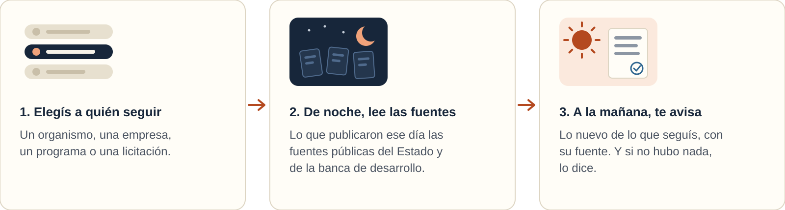
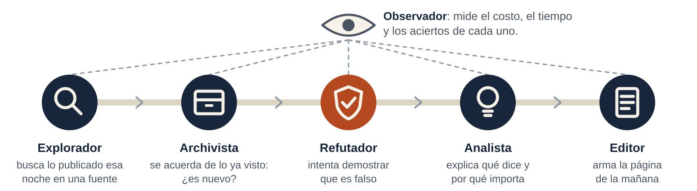
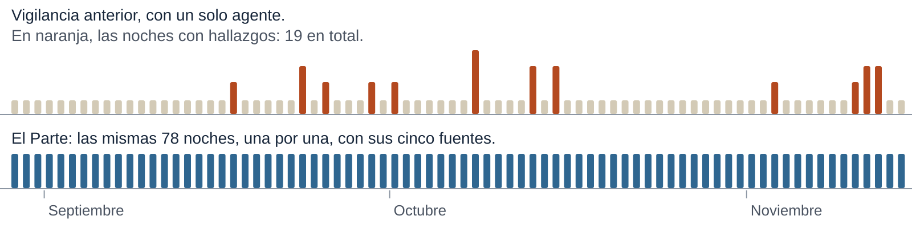
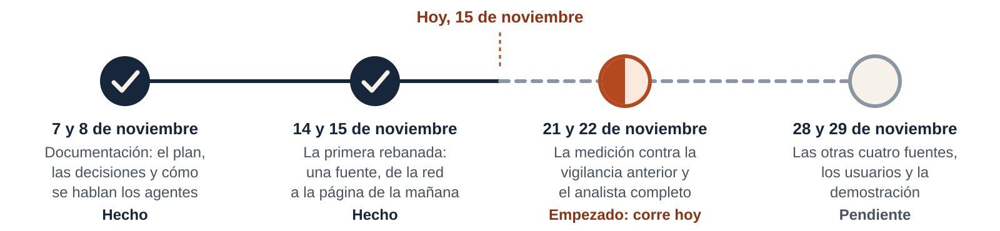

<!-- _class: oscura portada -->
<!-- _paginate: false -->
<!-- _footer: Solo en compras estatales se publicaron entre 550 y 670 documentos por día hábil en octubre de 2026. -->


### EL PARTE

# Cada día el Estado publica cientos de documentos. Nadie los lee todos.

El Parte los lee cada noche y a la mañana cuenta qué hay de nuevo, con la prueba de cada cosa.

<!--
El Parte es un proyecto didáctico. La idea entra en una frase: el Estado uruguayo publica muchísimo, en muchos sitios distintos, y nadie tiene tiempo de leerlo todo cada día. El Parte lo lee de noche y a la mañana dice qué hay de nuevo sobre lo que a uno le interesa. Lo que lo distingue es que cada cosa que dice lleva la prueba: el enlace a la fuente y un grado que dice cuán seguro está. El dato de abajo da la escala: solo el sitio de compras estatales publica entre 550 y 670 documentos por día hábil.
-->

---

## Qué hace El Parte



**Las cinco fuentes:** compras estatales (ARCE), que es la primera; BID; Banco Mundial; normativa de Presidencia, y Diario Oficial (IMPO). Hoy lee la primera; las otras cuatro entran al final del plan.

<!--
Tres pasos. Primero, cada persona elige qué entidades le interesan: un organismo como el BPS, una empresa, un programa. Segundo, de noche, El Parte lee lo que se publicó ese día en las fuentes públicas. Solo usa fuentes que permiten el uso de sus datos: datos abiertos, APIs o descargas oficiales; nada de sitios que prohíben la lectura automática. Tercero, a la mañana, cada persona ve lo nuevo sobre lo que sigue, con la fuente de cada cosa, y si no hubo nada nuevo la página lo dice en lugar de inventar. Son cinco fuentes en la versión 0. Por ahora anda la primera, compras estatales.
-->

---

<!-- _class: ejemplo -->
<!-- _footer: Esa noche leyó 571 publicaciones, se quedó con las 25 del BPS y verificarlas costó 0,22 USD. -->

## Un ejemplo real: una compra del BPS

```text
Lo que publicó compras estatales

buyer.name
  Banco de Previsión Social
tender.title
  Concurso de Precios 9807/2026
tender.description
  Contratación de servicio de mantenimiento
  integral de equipos aire acondicionado
  instalados en la sucursal del B.P.S. en la
  ciudad de Maldonado.
tender.tenderPeriod.endDate
  2026-09-14T11:00:00Z
```

> **Lo que dice El Parte a la mañana**
>
> “Banco de Previsión Social publicó el llamado Concurso de Precios 9807/2026 (Contratación de servicio de mantenimiento integral de equipos aire acondicionado instalados en la sucursal del B.P.S. en la ciudad de Maldonado.), con 1 ítem. Recibe ofertas hasta el 2026-09-14 11:00.”
>
> **PROVEN:** la fuente lo dice tal cual.

Fuente: [comprasestatales.gub.uy](https://www.comprasestatales.gub.uy/ocds/release/llamado-1367309), publicado el 28 de agosto de 2026 a las 11:20.

<!--
Un caso real, de la medición contra el banco de pruebas. A la izquierda, lo que publica el sitio de compras estatales: datos estructurados, en un formato abierto. A la derecha, cómo queda en la página de la mañana: una frase que se entiende, con el grado PROVEN porque la fuente dice exactamente eso, y el enlace para comprobarlo. Abajo, el embudo de esa noche: de 571 publicaciones, el explorador se quedó con las 25 que eran del BPS antes de llamar al modelo de lenguaje, y verificar esas 25 costó 22 centavos de dólar.
-->

---

## Por dentro: agentes con un solo trabajo cada uno

Un agente es un programa que usa un modelo de lenguaje para una tarea acotada. Se pasan el trabajo con mensajes, y cada mensaje queda guardado.



<!--
En lugar de un solo programa que hace todo, son varios agentes con un trabajo cada uno, que se pasan el trabajo como en una línea de montaje. El explorador busca en una fuente; hay uno por fuente porque cada fuente tiene su formato y sus fallas. El archivista es el único que recuerda: compara con lo que ya se vio para no anunciar dos veces lo mismo. El refutador, en naranja, es la pieza clave: intenta demostrar que cada hecho es falso, o viejo, o una deducción. El analista explica para qué sirve lo que sobrevive, y el editor arma la página de cada persona. Arriba, el observador mide todo: cuánto cuesta y cuánto tarda cada paso. Cada mensaje queda guardado, así que una noche se puede repetir entera sin costo para revisarla.
-->

---

<!-- _class: oscura -->
<!-- _footer: La noche del 29 de agosto: 25 compras del BPS, 22 PROVEN, 1 INFERRED y 2 NOT_MENTIONED. -->

## Por qué se le puede creer

El refutador intenta tirar abajo cada hecho y le pone uno de tres grados. El grado decide qué pasa con él.


| Grado | Qué quiere decir | Qué pasa |
|---|---|---|
| PROVEN | La fuente lo dice tal cual. | Se publica con su enlace. |
| INFERRED | Se deduce de la fuente, pero no está escrito. | Una persona lo revisa antes. |
| NOT_MENTIONED | La fuente no lo dice. | No se publica. |

<!--
Esta es la regla que hace que el sistema no mienta. Ningún hecho llega a nadie sin que un agente haya intentado probar que es falso: que la fecha sea real y no material viejo, que no sea el mismo hecho de otro día, que la fuente diga eso y no otra cosa. Sale con uno de tres grados. PROVEN, la fuente lo dice tal cual: se publica con su enlace. INFERRED, se deduce pero no está escrito: en esta versión, todo lo inferido pasa por una persona antes de mostrarse como seguro. NOT_MENTIONED, la fuente no lo dice: no se publica. Abajo, cómo salió una noche real.
-->

---

## Cómo sabemos si funciona

Otra vigilancia siguió al BPS durante 78 noches. El Parte repite esas noches y se compara.



| 5 de 5 | 12,71 USD | 1 de 5 |
|---|---|---|
| compras del BPS que la vigilancia descartó y El Parte publicó, 26 días antes | las 78 noches, en 3 horas y 23 minutos | fuentes en esta primera medición: compras estatales |

<!--
Para saber si El Parte sirve hace falta compararlo con algo. Entre el 29 de agosto y el 14 de noviembre, otra vigilancia siguió al BPS todas las noches con un solo agente y anotó lo que encontró y lo que descartó: 84 entradas, de las que 19 son hallazgos. El Parte vuelve a correr esas mismas 78 noches, una por una, pidiéndole a cada fuente lo que publicó esa fecha, y después se cuenta: cuánto de lo que encontró la vigilancia encontró también El Parte, cuánto de lo que publica El Parte está bien, y cuánto cuesta. Las 78 noches costaron 12,71 dólares y tardaron 3 horas y 23 minutos. El Parte encontró las cinco compras del BPS que la vigilancia había visto y descartado porque no eran de su tema, y las vio la noche en que se publicaron: una mediana de 26 días antes. Esta primera medición lee una sola de las cinco fuentes, así que de los 19 hallazgos solo uno estaba a su alcance, una compra directa, y no la encontró; falta saber si esa compra se publicó en compras estatales. De los casi 800 hechos que El Parte publicó y que la vigilancia no tenía, se juzgó un sorteo de 60: 57 estaban bien, una precisión estimada del 95 %. Los tres que no, nombraban a un solo proveedor en compras repartidas entre varios.
-->

---

## Dónde estamos



Es un proyecto didáctico: cada decisión, cada prueba y cada error quedan escritos en el repositorio, para que cualquiera entienda cómo se hizo. [github.com/andresdiegolanda/el-parte](https://github.com/andresdiegolanda/el-parte)

<!--
El plan de la versión 0 son cuatro fines de semana. El primero fue de documentación: antes de escribir código se decidió qué fuentes entran, cómo se hablan los agentes y cómo se guarda cada hecho. El segundo construyó la primera rebanada, chica pero completa: una sola fuente, compras estatales, desde la red hasta la página de la mañana. El tercero es medirse contra la vigilancia anterior: las 78 noches ya corrieron, y falta revisar lo que salió. El cuarto suma las otras cuatro fuentes, los usuarios y una cuenta de demostración. Todo queda documentado en el repositorio, incluido lo que salió mal, porque mostrar cómo se hizo es tan importante como el resultado.
-->
