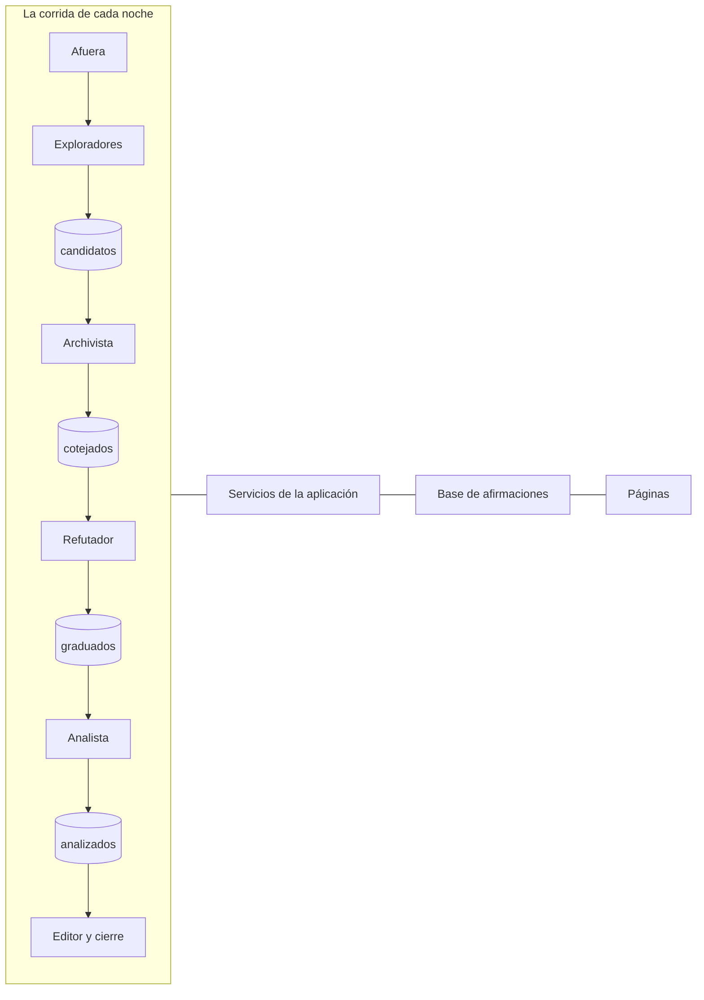

# El tablero de arquitectura

El sistema de El Parte objeto por objeto, en una sola página: cada agente, servicio, tópico de Kafka, tabla, página y servicio de afuera, con lo que hace, para qué sirve, cómo se conecta con los demás y dónde está su código. Lo construido va en trazo lleno; lo diseñado y sin construir, en punteado violeta y con la tarjeta del [tablero](../../tablero.md) que lo construye.

Se abre con [`index.html`](index.html) en cualquier navegador, desde un clon del repositorio. No necesita servidor ni conexión.

## Las vistas

Además del tablero completo, hay vistas: una parte del sistema con su propia grilla, sacada del mismo `sistema.json`, así no pueden contradecirse. Cada ficha de una vista dice qué conexiones del objeto quedan afuera y lleva al tablero completo.

| Vista | Archivo | Qué muestra |
|---|---|---|
| Todo el sistema | [`docs/tablero-de-arquitectura/index.html`](index.html) | Todos los objetos y todas las flechas. |
| El usuario | [`docs/tablero-de-arquitectura/usuarios.html`](usuarios.html) | Cómo entra cada persona, dónde queda su perfil y cómo lee su parte cada mañana ([ADR 0013](../../adrs/0013-acceso-perfil-y-parte-diario.md)). |

## La regla

**Este tablero refleja la arquitectura del sistema con precisión y exactitud en todo momento** ([ADR 0012](../../adrs/0012-tablero-de-arquitectura.md)):

- **Todo cambio se hace acá en el mismo momento.** Un cambio del código o del diseño que toca la arquitectura (un agente, un tópico, una tabla, una flecha, algo que pasa de diseñado a construido) cambia `sistema.json` en el mismo cambio, y se anota en su historial.
- **Los pedidos se hacen citando el tablero.** Cada objeto y cada flecha tiene una referencia estable, que la ficha muestra y deja copiar:

  | Qué se cita | Cómo | Ejemplo |
  |---|---|---|
  | Un objeto | `arquitectura: <id>` | `arquitectura: refutador` |
  | Una flecha | `arquitectura: <origen>><destino>` | `arquitectura: refutador>modelo` |
  | Un objeto, como enlace | `index.html?objeto=<id>` | `index.html?objeto=base/hechos` |
  | Una parada de un recorrido | `index.html?recorrido=<id>&paso=<n>` | `index.html?recorrido=noche&paso=7` |

- **El verificador lo compara con el código** en cada cambio (`python3 herramientas/verificar_docs.py`, punto 10). Si no coinciden, falla y dice qué falta.

## Cómo se lee

- **Cuatro franjas.** Arriba, la corrida de cada noche, de izquierda a derecha: del inicio al informe, con los tópicos de Kafka en las columnas sombreadas. Debajo, los servicios que usan los agentes; la base de afirmaciones, tabla por tabla; y las páginas.
- **Colores de los objetos:** agente, servicio, tópico, tabla, página, de afuera e infraestructura. Las marcas sobre la caja dicen **DISEÑADO**, **COMÚN** (lo usan muchos y no se le dibujan las flechas de uso) o **APAGADA**.
- **Flechas:** el color dice qué pasa (un mensaje por Kafka, escribe, lee, usa, llama afuera); el trazo, si está construida (lleno) o diseñada (punteado violeta); el grosor, si es el camino de un hecho (grueso) o algo auxiliar (fino). Las lecturas de la base están ocultas hasta que se elige un objeto, o con el botón Lecturas.
- **Recorridos:** caminos por el sistema, parada por parada: una noche normal, su repetición sin red ni costo, cuando algo falla, la misma compra otra noche, cómo termina una corrida y lo que falta construir.

El botón "Cómo se usa" de la página explica el resto: fichas, menú del botón derecho, teclado y botones.

## Qué hay en esta carpeta

| Archivo | Qué es | ¿Se edita a mano? |
|---|---|---|
| `sistema.json` | El modelo: franjas, columnas, grupos, nodos, flechas, recorridos e historial. Es la fuente. | Sí |
| `plantilla.html` | Cómo se ve y cómo se usa la página. | Sí |
| `index.html` | El tablero completo, generado desde los dos de arriba. | No |
| `usuarios.html` y las demás vistas | Una página por vista, generada igual. | No |
| `README.md` | Este archivo. | Sí |

## Cómo se cambia

1. Se cambia `sistema.json`: el nodo, la flecha o el texto que corresponda. Un objeto nuevo necesita un `id` estable, su `col` y su `fila` en la grilla (una celda libre), y su `que_es` y `para_que`. Lo construido cita su código en `codigo`; lo diseñado, su tarjeta en `tarjetas`.
2. Se suma una entrada al final de `historial`, con la fecha, qué cambió y los ids de los objetos tocados: el botón Cambios los resalta.
3. Se regenera la página: `python3 herramientas/generar_tablero_arquitectura.py`.
4. Se corre el verificador: `python3 herramientas/verificar_docs.py`. Si dice que falta una flecha o que sobra una, se corrige `sistema.json` o el código, según cuál esté mal.
5. Si se tocó la plantilla, se prueba la página: `NODE_PATH=<carpeta con puppeteer> node herramientas/pruebas/prueba_tablero_arquitectura.mjs`.

### Los campos

| En | Campo | Qué es |
|---|---|---|
| nodo | `id` | La referencia del objeto. No se cambia: los pedidos y los enlaces la usan. |
| nodo | `tipo` | `agente`, `servicio`, `topico`, `tabla`, `pagina`, `externo`, `infra` o `grupo-de-topicos`. |
| nodo | `estado` | `construido` o `disenado`. |
| nodo | `col`, `fila` | Su celda en la grilla. Dos objetos no comparten celda. |
| nodo | `codigo`, `docs`, `tarjetas` | Rutas del repositorio y tarjetas del tablero. |
| nodo | `topico`, `tabla`, `rutas` | El nombre del tópico, de la tabla (`esquema.tabla`) o las rutas web (`GET /manana`). |
| nodo | `comun` | Lo usan muchos objetos; el verificador no pide flechas de uso hacia él. |
| flecha | `de`, `a` | Los ids de los dos extremos. El `id` de la flecha es `<de>><a>`. |
| flecha | `tipo` | `emite` y `escucha` (tópicos), `escribe` y `lee` (tablas), `usa` (otro objeto) o `llama` (afuera). |
| flecha | `papel` | `camino`, el de un hecho por la corrida, o `auxiliar`. |
| flecha | `etiqueta`, `detalle`, `fuente` | Qué pasa por ahí, en corto y en largo, y de dónde sale. |
| flecha | `marco` | La biblioteca que la hace, configurada en el código pero sin nombrar la tabla, como Spring Security con sus tokens: el verificador no la busca en el código. |
| recorrido | `pasos` | Cada parada: `en` (un id de nodo o de flecha) y `texto`. |
| vista | `id`, `archivo`, `boton`, `titulo`, `sub` | Su identidad, su página y cómo se nombra. |
| vista | `franjas`, `columnas`, `grupos`, `posiciones` | Su propia grilla: `posiciones` dice la celda de cada objeto de la vista, que tiene que existir en el modelo. |
| vista | `recorridos` | Los recorridos que muestra; todas sus paradas tienen que estar en la vista. |

## Qué controla el verificador, y qué no

Controla, en los dos sentidos:

- Que cada clase Java de `app/src/main/java` y cada plantilla web esté en un solo objeto.
- Que los tópicos construidos sean los de `Tipos.java`, y las tablas construidas, las que crean las migraciones.
- Que cada `emisor.emitir` del código sea una flecha `emite`; cada `@KafkaListener`, una `escucha`; cada `insert`, `update` o `delete` en un texto SQL, una `escribe`; cada tabla nombrada en otro texto SQL, una `lee`; cada dependencia del constructor hacia otro objeto que no es común, una `usa`. Y que cada una de esas flechas construidas esté en el código.
- Que cada página construida atienda exactamente las rutas que dice.
- Que lo diseñado cite tarjetas que existen y no están todas hechas: si ya se construyó, pasa a construido.
- Que cada vista ubique objetos que existen, sin dos en una celda, y que sus recorridos quepan en ella.
- Que `index.html` y cada vista sean exactamente lo que se genera desde `sistema.json`, y que no sobre ninguna página.

No controla, y se revisa a mano en cada cambio: los textos de cada objeto y cada flecha, los recorridos, las flechas `llama` (hacia afuera), las que salen de un objeto `externo` (una persona que usa una página), las que tienen `marco` y lo diseñado más allá de su tarjeta.

El control está en [`herramientas/tablero_arquitectura.py`](../../herramientas/tablero_arquitectura.py), y su prueba en [`herramientas/pruebas/prueba_tablero_arquitectura.py`](../../herramientas/pruebas/prueba_tablero_arquitectura.py).
