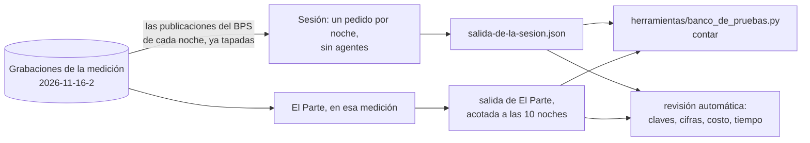

# El Parte contra una sesión con el modelo

Verificación hecha el 2026-11-18 (tablero, T42). La pregunta: si una persona le da a Claude, en una sesión como la de la Claude Console, lo que ARCE publicó del BPS cada noche, ¿qué parte sale, y qué agrega El Parte que esa sesión no da? Se mide con el mismo banco de pruebas y la misma herramienta de conteo ([banco-de-pruebas/metricas.md](../../banco-de-pruebas/metricas.md)).

## Cómo se comparó

- **Las noches.** Diez noches hábiles del registro: las seis en que El Parte encontró los publicables de ARCE, la del hallazgo de ARCE que El Parte no encontró (publicado el 2026-09-09), y tres al azar con la semilla 20261118: 2026-09-09, 2026-09-11, 2026-09-14, 2026-09-18, 2026-09-23, 2026-10-05, 2026-10-06, 2026-10-07, 2026-11-04 y 2026-11-09.
- **Lo que lee cada lado.** Las mismas publicaciones: las del BPS que El Parte leyó en la medición `2026-11-16-2`, con la noche y el día de margen, ya tapadas, sacadas de las grabaciones de esa medición.
- **La sesión.** Un pedido por noche al mismo modelo que usa el refutador de El Parte, con todas las publicaciones de la noche y una consigna corta: un hecho por novedad, con su ocid, su tipo, la afirmación, el grado y los campos que la respaldan. Sin agentes, sin base y sin memoria de las noches anteriores. La consigna y el programa están en `herramientas/sesion_de_comparacion.py`. Corrió en un contenedor en la máquina del responsable, con la clave del `.env` pasada al entorno sin escribirla en ningún lado.
- **El conteo.** Las dos salidas, la de la sesión y la de El Parte acotada a esas noches, se cuentan con `herramientas/banco_de_pruebas.py contar` contra el registro y su revisión. Lo que no necesita a una persona se revisa con `herramientas/sesion_de_comparacion.py revisar`: claves que no están en las publicaciones, tipos que no existen y cifras que no están en la publicación, con la regla del analista ([ADR 0015](../../adrs/0015-que-puede-escribir-el-analista.md)), que acepta una fecha escrita de otra forma.

## Lo que dio

| | El Parte | La sesión |
|---|---|---|
| Publicables de ARCE encontrados | 5 de 5 | 5 de 5 |
| El hallazgo de ARCE de esas noches | no lo encontró | tampoco |
| Hechos | 175 | 310 |
| Graduados INFERRED | 16 | 4 |
| Descartados antes de publicar (NOT_MENTIONED) | 7: 6 veredictos cortados y 1 refutación | ninguno: nadie los revisa |
| Con una cifra que no está en la publicación | 2 | 6 |
| Con una clave que no está en las publicaciones | ninguno | ninguno |
| Juzgados por una persona, bien de los juzgados | 35 de 36 | 11 de 11 |
| Sorteo de 20 hechos juzgado por una persona | | 20 de 20 correctos |
| Sin juzgar | 132 | 234 |
| Costo de las diez noches | 4,11 USD | 1,53 USD |
| Tiempo de las diez noches | 2.681 s | 517 s |

[PROVEN: `tmp/consola/medicion-de-el-parte.json`, `tmp/consola/medicion-de-la-sesion.json` y `tmp/consola/revision-automatica.json` en la máquina del responsable, 2026-11-18. No se versionan porque el conteo trae el detalle del registro.]

- **La cobertura empata.** Con las mismas publicaciones, los dos lados encuentran los mismos cinco publicables, con los mismos días de adelanto sobre la vigilancia anterior, y los dos se pierden el mismo hallazgo.
- **La sesión cuenta de nuevo lo que ya contó.** Sin memoria de las noches anteriores, repite cada compra que vuelve a aparecer en el día de margen o en una aclaración. El Parte la reconoce en el archivista y no la publica dos veces. [INFERRED: de los 310 hechos contra los 175, y de que la sesión no recibe nada de las noches anteriores]
- **La sesión no se refuta, y El Parte casi no refutó.** Casi todo lo de la sesión sale PROVEN, porque nadie vuelve a preguntar. En El Parte, el refutador vuelve a leer cada publicación, pero de sus 7 descartes, 6 fueron veredictos que se cortaron antes del grado ([docs/como-se-hizo/veredictos-cortados.md](../como-se-hizo/veredictos-cortados.md)), y solo 1, una adjudicación, fue una afirmación que no se sostenía. [PROVEN: base guardada de la medición `2026-11-16-2`, 2026-11-18] Con el arreglo de T48, esos 6 se habrían publicado.
- **Ninguno inventa cifras en esta muestra.** Las 6 de la sesión que la prueba marca son, en los ejemplos revisados, montos redondeados o escritos con otros decimales: la publicación dice 1803.2787 y la sesión, 1.803,28; la publicación dice 20.9 y la sesión, 20,90. No son inventadas, pero tampoco son lo que dice la fuente. Las 2 de El Parte son el número de adjudicaciones de una compra repartida, que cuenta el explorador. [PROVEN: las publicaciones de ocds-yfs5dr-1364695 y ocds-yfs5dr-1368546, y las afirmaciones de El Parte, 2026-11-18] La diferencia no está en lo que pasó, sino en lo que puede pasar: en El Parte, una cifra que no está en la evidencia no se publica; en la sesión, nada lo impide.
- **Cuesta un tercio y tarda un quinto.** Un pedido por noche con todo junto es más barato que un pedido por candidato al refutador y otro al analista.

## La precisión

Una persona juzgó un sorteo de 20 hechos de la sesión, con la semilla 20261118 y la misma escala que los extras de El Parte: los 20 son correctos. Los campos que cita cada uno coinciden con su publicación, y sus cifras están en ella; uno llama "análisis de laboratorio" a ocho renglones entre los que hay un colirio, y se juzgó correcto. [PROVEN: `tmp/consola/sorteo-de-la-sesion.jsonl` en la máquina del responsable, juzgado el 2026-11-18] Con 20 de 20, el intervalo de Wilson va de 0,84 a 1; el de los 36 hechos juzgados de El Parte, de 0,86 a 0,99. Con estas muestras, la precisión de los dos lados no se distingue.

## Lo que se concluye

En diez noches del BPS, una sesión con el modelo encuentra lo mismo que El Parte, con la misma precisión, por un tercio del costo y en un quinto del tiempo. Lo que El Parte agrega no es encontrar ni acertar: es no contar dos veces lo que ya contó (175 hechos contra 310), no dejar publicar una cifra que no está en la evidencia, que en la sesión nada impide, y medirse contra el banco noche por noche. La refutación, que era el argumento más fuerte, en esta muestra descartó una sola afirmación, y la mayor parte de lo que parecía refutación eran veredictos cortados. [INFERRED: de la tabla, el sorteo y la base de la medición] Si algo se recorta de El Parte, el primer candidato es el costo del refutador por candidato, no la memoria del archivista.

## Qué falló

- **Respuestas cortadas.** La primera vuelta pidió hasta 8.000 tokens de salida: siete de las diez noches quedaron cortadas a la mitad, con el JSON sin cerrar. Se vio al revisar las respuestas, todas de casi el mismo largo. Se volvieron a pedir esas siete con 32.000 tokens; el primer intento costó cerca de 1 USD sin resultado. En la Console, quien lee la respuesta pediría que siga.
- **El sorteo de la revisión.** El conteo de una salida que no es la del sorteo se negaba a contar ("hay que sortear de nuevo"). Se contó con una copia de la revisión sin el sorteo, en `tmp/`, y se borró después. Desde el 2026-11-18 el conteo sale sin la estimación del sorteo y lo dice, en `hechos.sorteoDeOtraSalida` ([banco-de-pruebas/metricas.md](../../banco-de-pruebas/metricas.md)).
- **Las fechas como cifras.** La prueba de cifras marcaba "14/09/2026" como inventada cuando la publicación dice 2026-09-14. Ahora una cifra vale si está entera o si están todas sus partes.
