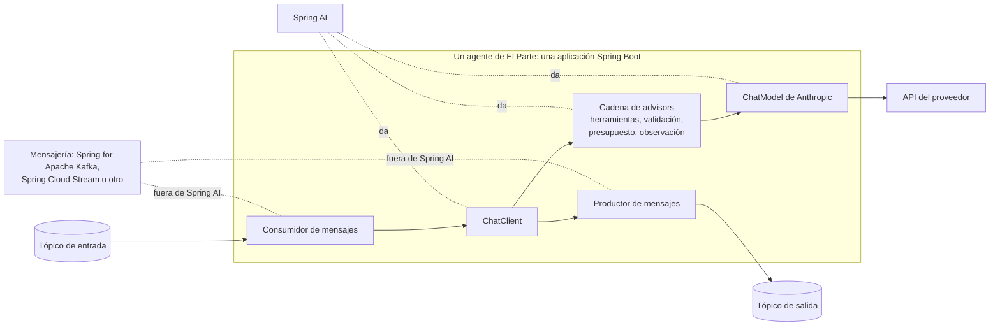

# Spring AI: qué ofrece hoy

Verificación de Spring AI hecha el 2026-11-07 (tarjeta T09), contra su documentación oficial, su blog y lo publicado en Maven Central. Es la base para la arquitectura (T02) y para el ADR del stack (T05).

Spring AI es el proyecto de Spring para usar modelos de lenguaje desde Java. Las preguntas eran cuatro: qué versión está vigente, qué patrones de orquestación de agentes documenta, cómo abstrae el proveedor del modelo y si trae integración con mensajería en tópicos.

## En una línea

Spring AI da muy buenas piezas para escribir **cada agente** por dentro (cliente de modelo, herramientas, salida estructurada validada, métricas de tokens), pero **no coordina agentes entre sí**: los patrones de orquestación que documenta son ejemplos de código, y la mensajería sale de otros proyectos de Spring. La orquestación por tópicos de El Parte la escribe el proyecto.

## 1. Versión vigente

- La versión estable es la **2.0.2**, publicada el 2026-10-22. Antes salieron la 2.0.0, el 2026-06-12, y la 2.0.1, el 2026-08-20. [PROVEN: listado de `org/springframework/ai/spring-ai-bom` en Maven Central, https://repo1.maven.org/maven2/org/springframework/ai/spring-ai-bom/, 2026-11-07]
- La próxima, la **2.1.0**, está en candidata: la RC2 salió el 2026-11-05. [PROVEN: el mismo listado, 2026-11-07]
- La última versión de la línea 1.1 es la 1.1.8, del 2026-06-12. [PROVEN: el mismo listado, 2026-11-07]
- La documentación de referencia muestra la 2.0.2 como la estable. [PROVEN: https://docs.spring.io/spring-ai/reference/, 2026-11-07]
- La 2.0 está hecha para Spring Boot 4.0 y 4.1 y Spring Framework 7.0. [PROVEN: anuncio de la 2.0.0, https://spring.io/blog/2026/06/12/spring-ai-2-0-0-GA-available-now/, y guía de inicio, https://docs.spring.io/spring-ai/reference/getting-started.html, 2026-11-07]
- Corre con Java 17 o superior: el módulo principal de la 2.0.2 está compilado para Java 17. [PROVEN: `ChatClient.class` de `spring-ai-client-chat-2.0.2.jar` tiene versión de bytecode 61, que es Java 17, 2026-11-07]

La 2.0 cambió mucho respecto de la 1.x (opciones inmutables con builders, Jackson 3, el ciclo de herramientas movido a los advisors). Por eso, lo que se encuentre escrito sobre Spring AI 1.x sirve poco para El Parte. [PROVEN: anuncio de la 2.0.0, 2026-11-07]

## 2. Patrones de orquestación de agentes

### Lo que documenta la referencia

La página "Building Effective Agents" toma la distinción de Anthropic entre dos tipos de sistemas. [PROVEN: https://docs.spring.io/spring-ai/reference/api/effective-agents.html, 2026-11-07]

- **Flujos de trabajo** (*workflows*): el código fija el camino, y los modelos y las herramientas se llaman en pasos predefinidos.
- **Agentes**: el modelo decide sus propios pasos y qué herramientas usar.

La página recomienda los flujos de trabajo cuando la tarea está bien definida, porque son más predecibles, y describe cinco patrones: cadena, paralelización, ruteo, orquestador con trabajadores y evaluador con optimizador. [PROVEN: misma página, 2026-11-07]

**El código de esos patrones no es parte de la biblioteca.** Está en el directorio `agentic-patterns` del repositorio de ejemplos `spring-ai-examples`. Spring AI no trae una clase de "cadena" ni de "orquestador" para usar: son ejemplos para copiar y adaptar. [PROVEN: misma página, 2026-11-07]

### Lo que trae la 2.0 para construir agentes

- **Advisors en cadena.** Un *advisor* es un interceptor que envuelve cada llamada al modelo. En la 2.0, `ChatClient` hace pasar cada pedido por una cadena ordenada de advisors, y un advisor puede volver a recorrer la cadena. Con eso funcionan el ciclo de herramientas, los reintentos de salida estructurada y los ciclos de evaluación. [PROVEN: anuncio de la 2.0.0, 2026-11-07]
- **Herramientas.** `ToolCallingAdvisor` maneja el ciclo completo de llamadas a herramientas y `ChatClient` lo registra solo. Tiene ganchos antes y después de cada vuelta del ciclo, y una condición configurable que decide si hay otra vuelta. No trae un tope de vueltas propio. [PROVEN: https://docs.spring.io/spring-ai/reference/api/tools/tool-calling-advisor.html, 2026-11-07; la clase está en `spring-ai-client-chat-2.0.2.jar`]
- **Salida estructurada que se corrige sola.** La respuesta del modelo se valida contra el esquema JSON del tipo esperado y, si no cumple, se vuelve a pedir. [PROVEN: https://docs.spring.io/spring-ai/reference/api/structured-output/validation.html, 2026-11-07; `StructuredOutputValidationAdvisor` está en el mismo jar]
- **Métricas.** Spring AI registra observaciones con Micrometer, la biblioteca de métricas de Spring: una por llamada al modelo (`gen_ai.client.operation`) y otra por advisor (`spring.ai.advisor`). La métrica `gen_ai.client.token.usage` cuenta los tokens de entrada y de salida de cada llamada, incluidos los que se leen o escriben en la caché del proveedor. [PROVEN: https://docs.spring.io/spring-ai/reference/observability/index.html, 2026-11-07]

### Lo que está alrededor, fuera del núcleo

- **spring-ai-agent-utils**: herramientas inspiradas en Claude Code (subagentes, *skills*, memoria en archivos, protocolo A2A), presentadas en la serie "Spring AI Agentic Patterns" del blog de Spring entre enero y abril de 2026. Es un proyecto de la comunidad, no del equipo de Spring AI, y está en la versión 0.13.0, del 2026-10-03. [PROVEN: https://repo1.maven.org/maven2/org/springaicommunity/spring-ai-agent-utils/maven-metadata.xml, https://github.com/spring-ai-community/spring-ai-agent-utils y https://spring.io/blog/2026/01/27/spring-ai-agentic-patterns-4-task-subagents/, 2026-11-07]
- **spring-ai-session**: memoria de conversación basada en eventos, también de la comunidad. [PROVEN: anuncio de la 2.0.0, 2026-11-07]

## 3. Cómo abstrae el proveedor del modelo

- `ChatModel` es la interfaz común a todos los proveedores: cambiar de modelo pide cambios mínimos de código. [PROVEN: https://docs.spring.io/spring-ai/reference/api/chatmodel.html, 2026-11-07]
- En la 2.0, `ChatClient` es la API pensada para el uso diario, y `ChatModel` queda como pieza de bajo nivel. [PROVEN: anuncio de la 2.0.0, 2026-11-07]
- El núcleo de la 2.0 soporta de fábrica siete proveedores: OpenAI, Anthropic, Amazon Bedrock, Google GenAI, Mistral AI, DeepSeek y Ollama. [PROVEN: anuncio de la 2.0.0, 2026-11-07]
- Anthropic se usa a través del SDK oficial de Anthropic para Java, con el starter `spring-ai-starter-model-anthropic`. La clave se configura en `spring.ai.anthropic.api-key` o se toma de la variable de entorno `ANTHROPIC_API_KEY`, y el modelo en `spring.ai.anthropic.chat.model`. [PROVEN: https://docs.spring.io/spring-ai/reference/api/chat/anthropic-chat.html, 2026-11-07]
- El modelo y la temperatura se pueden cambiar en cada pedido, sin tocar la configuración por defecto. [PROVEN: misma página, 2026-11-07] Por lo tanto, cada agente puede usar un modelo distinto, como pide la decisión D4. [INFERRED: de la línea anterior]

Lo que no es portable son las funciones propias de cada proveedor, como la caché de prompts. Si El Parte usa alguna, queda atado a ese proveedor en ese punto. [INFERRED: la métrica de caché existe porque algunos proveedores la ofrecen y otros no]

## 4. Integración con mensajería en tópicos

- Spring AI no trae integración con sistemas de mensajería. La documentación de referencia de la 2.0.2 no tiene ninguna sección sobre Kafka, Spring Cloud Stream ni eventos entre aplicaciones. [PROVEN: índice de https://docs.spring.io/spring-ai/reference/, 2026-11-07]
- La mensajería es de otros proyectos de Spring que figuran en su documentación: Spring for Apache Kafka, Spring Cloud Stream, Spring AMQP, Spring for Apache Pulsar y Spring Modulith. [PROVEN: listado de proyectos en https://docs.spring.io/spring-ai/reference/spring-projects.html, 2026-11-07] Cuáles son compatibles con Spring Boot 4 se verifica en el ADR del stack (T05).

## Lo que esto le dice a El Parte

Lo que sigue son consecuencias para la arquitectura y el ADR del stack. Todas son INFERRED a partir de lo de arriba.

1. **La orquestación es del proyecto.** Cada agente es una aplicación (o un componente) que lee de un tópico, usa `ChatClient` y escribe en otro tópico. Spring AI va adentro de cada agente, no entre ellos.
2. **Una noche de El Parte es un flujo de trabajo, no un agente autónomo.** El camino está fijo: los exploradores en paralelo y después archivista, refutador, analista y editor en cadena. Es lo que la referencia recomienda para tareas bien definidas, y es lo que permite repetir una corrida desde sus mensajes.

   | Paso de la noche | Patrón de la referencia |
   |---|---|
   | Un explorador por fuente, todos a la vez | Paralelización |
   | Archivista, refutador, analista, editor | Cadena |
   | El refutador intenta tirar abajo cada candidato | Parecido al evaluador, pero sin optimizar: devuelve un grado |
   | Orquestador con trabajadores | No se usa: no hay subtareas imprevisibles |

3. **Los contratos entre agentes pueden apoyarse en la salida estructurada validada.** Cada agente devuelve un tipo Java con su esquema, y Spring AI reintenta si el modelo no lo cumple. Esto entra en `docs/contratos.md` (T03).
4. **El observador tiene de dónde medir.** Los tokens de entrada y de salida de cada llamada salen de Micrometer. El costo se calcula aparte, con los precios del proveedor verificados con fecha.
5. **El presupuesto por corrida se puede cortar adentro del agente**, con la condición que decide si hay otra vuelta de herramientas o con un advisor propio. El corte entre agentes, en cambio, lo decide la orquestación.
6. **No hace falta spring-ai-agent-utils.** Sus herramientas están pensadas para agentes interactivos y abiertos, al estilo de Claude Code, y es un proyecto de la comunidad todavía antes de su versión 1.0.
7. **Versión para el ADR del stack:** la 2.0.2 es la estable hoy y la 2.1 está por salir. Hay que decidir con cuál se arranca, y con qué Java (17 es el mínimo).

## Lo que no se pudo verificar

- **Cómo grabar y repetir respuestas del modelo en las pruebas** (D4). La referencia tiene una página de evaluación de modelos, pero no se encontró una forma documentada de reproducir respuestas grabadas. Queda para el ADR del stack (T05). [ASSUMED: se resuelve con un `ChatModel` propio que devuelve respuestas guardadas]
- **Compatibilidad de los proyectos de mensajería con Spring Boot 4.** No se revisó. Queda para el ADR del stack (T05).
