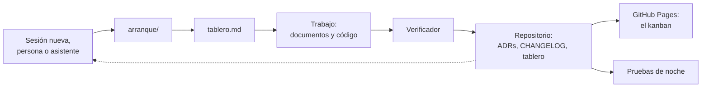

# La metodología: el repositorio como único handoff

Una forma de llevar un proyecto de software entre personas y asistentes que trabajan en sesiones sueltas, sin memoria entre una y otra. Todo lo que se decide, se aprende o falta hacer está escrito en el repositorio, con su evidencia, y una sesión nueva arranca leyendo una sola carpeta. Salió de El Parte entre el 2026-11-07 y el 2026-11-17. Esta carpeta la separa del proyecto para usarla en otro: lo que sigue explica la idea, las piezas y los pasos, y [`metodologia/plantillas/`](plantillas/README.md) tiene los archivos para copiar.

## La idea

1. **El repositorio es la memoria.** Lo que no está escrito no se sabe. Ninguna sesión depende de una conversación anterior.
2. **Documentación primero, con evidencia.** Cada afirmación técnica dice si está probada (con su fuente y su fecha), deducida o supuesta.
3. **Las decisiones tienen registro.** Cada una con sus razones, sus alternativas, lo que cuesta y qué la haría cambiar.
4. **Lo pendiente vive en un archivo de texto, con dueño.** Las vistas (el kanban, el sitio) se generan desde ahí y nadie las edita.
5. **Lo que se puede controlar lo controla un programa.** El verificador falla si algo no cumple; lo demás se relee.



## Las reglas

Son catorce, y están en [`metodologia/plantillas/README.md`](plantillas/README.md), que es el README del proyecto nuevo. Cómo se cumplen en una sesión (el ciclo, los grados de evidencia, los ADRs, el tamaño de cada cambio, la autorización de commits por tarea, lo temporal) está en [`metodologia/plantillas/arranque/como-se-trabaja.md`](plantillas/arranque/como-se-trabaja.md).

Las reglas de El Parte, en [`README.md`](../README.md), son las mismas con dos diferencias: su regla 13 es el tablero de arquitectura, que acá es una pieza opcional, y su "un solo lugar por dato" está en [`arranque/como-se-trabaja.md`](../arranque/como-se-trabaja.md) en lugar de ser una regla numerada ([ADR 0017](../adrs/0017-forma-de-trabajo-mas-liviana.md)).

## Las piezas

| Pieza | Qué es | Al adoptarla |
|---|---|---|
| `README.md` | Qué es el proyecto y sus reglas. | Plantilla |
| `arranque/` | Lo que lee una sesión nueva, en orden: el proyecto, cómo se trabaja, las decisiones iniciales, el mapa y el glosario. | Plantilla |
| `tablero.md` | Todo lo pendiente, en tarjetas con tipo, dueño, etapas, lista y registro. Es lo que manda. | Plantilla, con tres tarjetas para arrancar |
| `CHANGELOG.md`, `adrs/README.md`, `obsoletos/README.md` | La historia de cambios, el índice de decisiones y lo que dejó de usarse. | Plantilla |
| `.gitignore` | Deja afuera los secretos, `tmp/` y las páginas generadas. | Plantilla |
| `herramientas/tablero_md.py` | Lee y valida `tablero.md`. | Se copia tal cual |
| `herramientas/generar_kanban.py` y `kanban/plantilla.html` | Generan el kanban, de solo lectura, desde `tablero.md`. Toma el nombre y el objetivo del encabezado del tablero. | Se copian; de la plantilla se borra la línea del botón `btn-credito`, que es de El Parte |
| `herramientas/verificar_docs.py` | El verificador: guiones largos, enlaces, tablero, kanban, tarjetas y decisiones citadas, diagramas Mermaid y cifras repetidas. | Se copia tal cual: lo propio de El Parte se saltea si no está |
| `herramientas/armar_sitio.py` y `.github/workflows/publicar.yml` | Arman el sitio y lo publican en GitHub Pages en cada push a `main`. | Se copian; en `armar_sitio.py` se cambia `DESCRIPCION`. Si la aplicación está publicada, su dirección va en la variable `URL_DE_LA_APLICACION` del repositorio en GitHub Actions, y la portada suma el enlace |
| `herramientas/pruebas/prueba_kanban.mjs` | Abre el kanban en Chrome y comprueba que ande y que no se pueda editar. | Se copia tal cual |
| `.github/workflows/pruebas.yml` | Corre el verificador y cada prueba de `herramientas/pruebas/`, de noche si `main` cambió y a demanda. | Se copia tal cual; las pruebas propias del proyecto se suman como un trabajo más |

### Piezas de El Parte que se pueden sumar

- **Láminas de arquitectura en SVG**, generadas desde JSON con `herramientas/generar_laminas.py`. El verificador las controla si el módulo está.
- **Un tablero de arquitectura** que el verificador compara con el código ([ADR 0012](../adrs/0012-tablero-de-arquitectura.md)), con controles de dibujo y capturas en Chrome. La página se reutiliza, pero la comparación con el código (`herramientas/tablero_arquitectura.py`) está escrita para el stack de El Parte (Java, Kafka y PostgreSQL) y hay que reescribirla para otro.
- **Un banco de pruebas**: un registro de lo que encontró una vigilancia anterior, para medir contra él ([ADR 0014](../adrs/0014-medicion-contra-el-banco.md)). La idea sirve para cualquier proyecto que mida resultados; el formato es de El Parte.

## Cómo se adopta en un proyecto nuevo

Probado el 2026-11-17 en un repositorio de prueba: con estos pasos, el verificador, el kanban, el sitio y la prueba en Chrome pasaron sin tocar nada más. [PROVEN: repositorio de prueba en `tmp/`, 2026-11-17]

1. **Crear el repositorio en GitHub, público, y clonarlo.** En un repositorio público, las máquinas estándar de GitHub Actions, incluidas las que publican en GitHub Pages, no tienen costo. [PROVEN: <https://docs.github.com/en/billing/concepts/product-billing/github-actions>, 2026-11-17]
2. **Copiar las plantillas y las herramientas**, desde un clon de El Parte (en `$EP`) a la raíz del repositorio nuevo. Los comandos son de bash, con GNU sed: en Windows, Git Bash o WSL.

   ```sh
   cp -r "$EP/metodologia/plantillas/." .
   mkdir -p herramientas/pruebas kanban .github/workflows
   cp "$EP"/herramientas/{tablero_md.py,generar_kanban.py,verificar_docs.py,armar_sitio.py} herramientas/
   cp "$EP/herramientas/pruebas/prueba_kanban.mjs" herramientas/pruebas/
   cp "$EP/kanban/plantilla.html" kanban/
   cp "$EP"/.github/workflows/{publicar.yml,pruebas.yml} .github/workflows/
   ```

3. **Reemplazar los marcadores** en todos los archivos copiados:

   | Marcador | Qué va | Ejemplo |
   |---|---|---|
   | `{proyecto}` | El nombre del proyecto | Mi Proyecto |
   | `{repositorio}` | La dirección del repositorio | `https://github.com/usuario/mi-proyecto` |
   | `{sitio}` | La dirección de GitHub Pages, con barra al final | `https://usuario.github.io/mi-proyecto/` |
   | `{responsable}` | Quién decide en el proyecto, como dueño de tarjetas | Ana |
   | `{fecha}` | El día del arranque | 2026-11-17 |
   | `{idioma}` | El idioma y el registro de los documentos | Español rioplatense, con voseo |

   ```sh
   grep -rl "{proyecto}\|{repositorio}\|{sitio}\|{responsable}\|{fecha}\|{idioma}" . --exclude-dir=.git | xargs sed -i \
     -e 's|{proyecto}|Mi Proyecto|g' -e 's|{repositorio}|https://github.com/usuario/mi-proyecto|g' \
     -e 's|{sitio}|https://usuario.github.io/mi-proyecto/|g' -e 's|{responsable}|Ana|g' \
     -e 's|{fecha}|2026-11-17|g' -e 's|{idioma}|Español rioplatense, con voseo|g'
   ```

   Los demás textos entre llaves, como `{Qué es el proyecto...}`, son para escribir a mano: es la primera tarjeta del tablero (T01).
4. **Sacar lo propio de El Parte:** la línea del botón `btn-credito` de `kanban/plantilla.html` (`sed -i '/id="btn-credito"/d' kanban/plantilla.html`) y el texto de `DESCRIPCION` en `herramientas/armar_sitio.py`.
5. **Probar:**

   ```sh
   python3 herramientas/verificar_docs.py
   python3 herramientas/armar_sitio.py        # deja el sitio en tmp/sitio/ para mirarlo
   ```

   Para los diagramas, el verificador necesita mermaid-cli (`npm install -g @mermaid-js/mermaid-cli`); sin él, avisa y sigue. La prueba en Chrome es `NODE_PATH=<carpeta con puppeteer> node herramientas/pruebas/prueba_kanban.mjs`.
6. **Primer commit y push.** El primer intento de `publicar.yml` falla, porque GitHub Pages todavía no está prendido. [PROVEN: primera corrida de `publicar.yml` en El Parte, 2026-11-17]
7. **Prender GitHub Pages:** en el repositorio, Settings, sección Pages, en "Source" elegir "GitHub Actions". Después, en la pestaña Actions, volver a correr "Publicar los tableros" con "Re-run all jobs". [PROVEN: así se prendió en El Parte, 2026-11-17]
8. **Darle las instrucciones al asistente**, donde las lea al empezar cada sesión (un proyecto de Claude, un `CLAUDE.md`):

   ```text
   {proyecto} es <qué es, en una frase>.

   El contexto es el repositorio {repositorio} (rama main). Al empezar cualquier conversación de trabajo, cloná o actualizá el repositorio y leé la carpeta arranque/ en el orden que indica arranque/README.md. No hace falta nada más: lo que no está en el repositorio no se da por sabido.

   Lo que se decida o se aprenda en una conversación se escribe en el repositorio (ADR, tablero o CHANGELOG). Si algo de este texto contradice al repositorio, manda el repositorio.

   Commits y push según la autorización de cada tarea (arranque/como-se-trabaja.md).
   ```

9. **Empezar por el tablero:** T01 (qué es el proyecto) y T02 (las decisiones iniciales) están en "Para empezar".

## Por qué es así: lo que enseñó El Parte

- **Un kanban editable cuesta más de lo que da.** El primer kanban se generaba desde el tablero ([ADR 0001](../adrs/0001-tablero-fuente-unica-kanban-generado.md)); después se hizo editable, con una base y una sincronización ([ADR 0009](../adrs/0009-kanban-editable-sincronizado.md)); al final volvió a ser de solo lectura, porque la sincronización pedía decenas de operaciones para mover unas pocas tarjetas ([ADR 0017](../adrs/0017-forma-de-trabajo-mas-liviana.md)).
- **Una cifra repetida termina contradiciéndose.** Cambiar un solo valor tocó 17 archivos, porque estaba copiado en el tablero, los README, un ADR y dos páginas. De ahí sale "un solo lugar por dato", con un aviso del verificador (ADR 0017).
- **Un ritual igual para todo encarece lo chico.** De ahí el tamaño de cada cambio: chico, mediano o grande, cada uno con lo suyo (ADR 0017).
- **Lo generado no se edita ni se versiona.** El HTML generado ensuciaba cada diff. Se versiona la fuente y la página se publica; las láminas SVG sí se versionan, porque GitHub las muestra dentro de los Markdown (ADR 0017).
- **Primero los términos de uso, después la consulta.** En El Parte se consultó un sitio antes de leer sus términos, que prohibían la consulta automática ([docs/fuentes/bps.md](../docs/fuentes/bps.md)). De ahí la regla de leerlos antes.
- **Un dibujo se mide, no solo se mira.** Los controles de posición encontraron rótulos y textos que se pisaban en el tablero de arquitectura, y que no se habían notado mirándolo (ADR 0017).
- **La autorización va por tarea, no por mensaje.** Pedir permiso para cada commit sumaba una vuelta en cada cierre; ahora se autoriza al empezar la tarea y queda anotado en su tarjeta (ADR 0017).
- **Lo temporal necesita un lugar.** Los volcados, parches y capturas de las sesiones quedaban sueltos en la carpeta temporal del sistema; ahora van en `tmp/`, que no se versiona (regla 14 de El Parte).

## Cómo se mantiene

Esta carpeta describe el método de El Parte, así que cambia con él: cuando un ADR o un cambio de `arranque/como-se-trabaja.md` toca la forma de trabajar, en el mismo cambio se actualizan `metodologia/README.md` y las plantillas que correspondan, y se vuelven a probar los pasos de adopción en un repositorio de prueba en `tmp/`.
