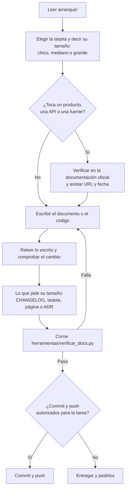

# Cómo se trabaja

Las catorce reglas están en el [README](../README.md). Acá está cómo se cumplen en una sesión de trabajo, sea de una persona o de un asistente.

## El ciclo de una sesión



## Al empezar

1. Traer la última versión del repositorio.
2. Leer la carpeta `arranque/` en el orden de su [README](README.md).
3. Elegir la tarjeta en el [tablero](../tablero.md): la primera de "Para empezar", salvo que haya un motivo para otra. Si lo que hay que hacer no está en el tablero, primero se agrega la tarjeta, con dueño.
4. Decir su tamaño (ver "El tamaño de cada cambio") y si el responsable autoriza commit y push al terminar.
5. Mover su bloque a "En curso" y anotar en su registro el tamaño y, si la hay, la autorización.

## Mientras se trabaja

### Grados de evidencia (regla 2)

Toda afirmación técnica lleva su grado entre corchetes, al final de la frase o del punto:

- `[PROVEN: <URL o comprobación>, <fecha>]`: está verificado. La fuente es la documentación oficial (con su URL) o una comprobación hecha y descrita (un comando que se corrió y lo que devolvió).
- `[INFERRED: <de qué se deduce>]`: se deduce de algo verificado, pero no se comprobó directamente.
- `[ASSUMED]`: es un supuesto de trabajo. Todo ASSUMED que sostenga una decisión tiene una tarjeta en el tablero para verificarlo.

Cuando una sección entera tiene el mismo grado y la misma fuente, se dice una vez al principio de la sección.

### Nada de memoria

Lo que se afirma sobre un producto, una API o una fuente externa se contrasta con la documentación oficial antes de escribirlo, y se anota la URL y la fecha de consulta. Lo que se sabía de antes no cuenta como fuente. Antes de consultar un sitio de forma automática, se leen sus términos de uso y su robots.txt.

### Decisiones (regla 3)

Toda decisión significativa es un ADR (registro de decisión de arquitectura) en `adrs/`, con nombre `NNNN-titulo-corto.md` y número correlativo. Cada ADR tiene estas secciones:

```markdown
# NNNN. Título

- Estado: propuesto | aceptado | reemplazado por NNNN
- Fecha: AAAA-MM-DD

## Contexto
Qué problema hay y qué lo condiciona.

## Decisión
Qué se decidió.

## Razones
Por qué, con grados de evidencia.

## Alternativas rechazadas
Cada una con el motivo.

## Costos
Lo que se paga por esta decisión.

## Qué la haría reversar
La señal concreta que obligaría a revisarla.
```

Un ADR aceptado no se edita: si cambia la decisión, se escribe uno nuevo que lo reemplaza y el viejo pasa a "reemplazado por". El índice está en [`adrs/README.md`](../adrs/README.md). Las decisiones de arranque que todavía no tienen ADR están en [decisiones-iniciales.md](decisiones-iniciales.md).

### Diagramas (regla 5)

Flujos, secuencias y estados van en Mermaid dentro del Markdown. El verificador dibuja cada diagrama y falla si alguno no se puede dibujar. Lo que se genera desde una fuente (una página, una lámina) no se edita a mano: se cambia la fuente y se vuelve a generar.

### La página "cómo se hizo" de cada componente (regla 6)

Cada componente tiene su página en `docs/como-se-hizo/<componente>.md` con seis secciones: qué hace, por qué existe, cómo se construyó, qué se probó, qué falló y qué se cambió. Lo que falló se escribe con el mismo cuidado que lo que anduvo: qué se esperaba, qué pasó, cómo se detectó y qué se cambió.

### Estilo (regla 7)

- {idioma}.
- Sin guiones largos en ningún archivo. El verificador lo controla. Para cortar una frase se usan dos puntos, coma, punto o paréntesis.
- Cada término técnico se explica la primera vez que aparece en un documento, o se enlaza al [glosario](glosario.md). Si el término no está en el glosario, se agrega.
- Cada archivo se nombra con su ruta desde la raíz del repositorio, entre comillas invertidas: `docs/como-se-hizo/login.md`, no "la página del login".
- Los documentos versionados describen decisiones y objetivos del proyecto, no conversaciones entre quienes trabajan en él.

### Lo sensible (regla 11)

Las claves van en un `.env` que no se versiona y que ninguna sesión abre. Los datos personales y el material de otros proyectos no entran al repositorio: si una tarea los necesita, quedan en una carpeta excluida en `.gitignore` y al repositorio van solo su formato, sus cuentas o sus huellas.

### Un solo lugar por dato (regla 13)

Cada cifra, valor o decisión vive en un solo documento, y los demás lo enlazan sin repetirlo: el resultado de una medición, en su documento; un valor decidido, en su ADR; el estado de una tarea, en su tarjeta; cómo se construyó algo, en su página "cómo se hizo". La nota de arriba del tablero, los README y el plan dicen dónde mirar. `CHANGELOG.md`, los ADRs, las decisiones iniciales y el registro y las tarjetas hechas del tablero son historia: cuentan qué pasó, con las cifras de su momento. El verificador avisa, sin fallar, cuando la misma cifra con unidad aparece en más de un documento vigente.

### El tamaño de cada cambio

| Tamaño | Qué es | Qué lleva |
|---|---|---|
| Chico | Un arreglo, un texto, un valor de configuración. No cambia contratos, decisiones ni el diseño. | Commit y una línea en `CHANGELOG.md`. Si es parte de una tarjeta, una línea en su registro. |
| Mediano | Un componente nuevo o un cambio de comportamiento dentro de lo decidido. | Lo del chico, más la tarjeta con sus etapas y la página "cómo se hizo". |
| Grande | Cambia una decisión, un contrato o la forma de trabajo. | Lo del mediano, más un ADR aceptado antes del código. |

La sesión dice el tamaño al empezar, y el responsable lo puede cambiar.

### El tablero y el kanban (regla 8)

[`tablero.md`](../tablero.md) es lo que manda sobre lo pendiente. Cada pendiente es una tarjeta: un bloque `###` debajo de la columna en la que está. El propio tablero explica el formato, los tipos con sus etapas y las reglas de cada columna.

- Mover una tarjeta es mover su bloque a otra columna y sumar una línea a su registro.
- `tablero.md` tiene que estar en formato canónico: leerlo y volver a escribirlo con `herramientas/tablero_md.py` da el mismo archivo. El verificador lo controla.
- El kanban es una vista de solo lectura de `tablero.md`, publicada en <{sitio}kanban/>. Para verlo en una sesión, `python3 herramientas/generar_kanban.py` lo genera en `kanban/index.html`, que no se versiona.

### Lo publicado y las pruebas

Dos workflows de GitHub Actions, en `.github/workflows/`:

- **`publicar.yml`**, en cada push a `main`: `herramientas/armar_sitio.py` genera el kanban y lo publica en GitHub Pages, en <{sitio}>. No corre pruebas.
- **`pruebas.yml`**, todas las noches si `main` cambió en el último día, y a demanda: el verificador y las pruebas del proyecto. No usa secretos.

### Nada se borra (regla 9)

Lo que sobra se mueve a [`obsoletos/`](../obsoletos/README.md), manteniendo su ruta relativa debajo de esa carpeta, y se anota en el índice de `obsoletos/README.md`: qué era, cuándo se movió, por qué y qué lo reemplaza. Lo que se genera (las páginas del kanban) no se versiona, así que esta regla no lo alcanza: se vuelve a generar.

### Lo temporal (regla 14)

Todo lo temporal de una sesión va en `tmp/`, en la raíz del clon. La carpeta está en `.gitignore` y el verificador no la revisa.

- **Va en `tmp/`:** los parches, los registros, las capturas de pantalla, el sitio armado para mirarlo (`tmp/sitio/`), los scripts de un solo uso y las listas o tablas para mirar.
- **No va en `tmp/`, porque tiene su lugar:** los secretos, en `.env`, y lo que las herramientas generan donde lo esperan.
- **Lo que está en `tmp/` se puede volver a armar o ya no hace falta.** Lo que se aprende o se decide pasa al repositorio. Por eso la regla 9 no alcanza a `tmp/`: se puede vaciar cuando lo que tiene ya no sirve.
- **Una herramienta que necesita una carpeta temporal propia** usa la del sistema y la borra al terminar.

### Releer (regla 12)

Después de cada escritura se relee el archivo y se comprueba que el cambio quedó como se quería. Antes de entregar se corre el verificador:

```sh
python3 herramientas/verificar_docs.py
```

Controla que no haya guiones largos, que los enlaces relativos de los Markdown apunten a archivos que existen, que el tablero respete su formato y sus reglas, que el kanban se pueda generar, que toda tarjeta o decisión citada exista, que cada diagrama Mermaid se pueda dibujar y que no haya cifras repetidas. Si algo falla, termina con código 1 y dice dónde.

Para dibujar los diagramas usa mermaid-cli (el programa `mmdc`), que busca en la variable de entorno `MMDC` o en el `PATH`. Si no lo encuentra, avisa y sigue; con `EXIGIR_MERMAID=1` falla.

## Al terminar

Lo que lleva cada cambio depende de su tamaño (ver "El tamaño de cada cambio"). Lo que corresponda de esta lista:

1. Una entrada corta en el [CHANGELOG](../CHANGELOG.md): qué cambió, dónde, y el enlace al documento que tiene el porqué.
2. El [tablero](../tablero.md) al día: la tarjeta en su columna, con sus etapas, su lista y su registro, y una tarjeta nueva por cada cosa que quedó pendiente.
3. Si se tomó una decisión significativa, su ADR.
4. Si el trabajo enseñó algo que contradice un documento, se corrige el documento (regla 1).
5. La línea de estado de [arranque/README.md](README.md) al día.

### Commits

Commit y push se autorizan por tarea: al empezar, el responsable del proyecto dice si la tarea incluye commit y push al terminar, y se anota en el registro de su tarjeta. Con esa autorización, la sesión hace commit y push al terminar, sin volver a pedirlos. Sin ella, no se hacen commits ni push sin un pedido explícito. Los mensajes van en el idioma del proyecto: una primera línea corta con qué cambió y, si hace falta, un cuerpo que enlace al documento con el porqué.

## Entorno de trabajo

- El repositorio vive en <{repositorio}>. La rama principal es `main`.
- {Qué hace falta instalar para trabajar, y cómo se prueba que anda.}
